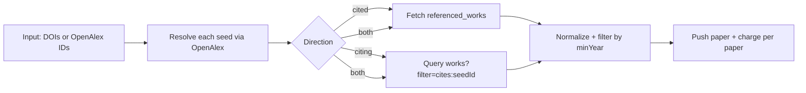

# Research Citation Explorer: Map Any Paper's Citation Network

[](https://apify.com/Turboextract/research-citation-explorer)
[](LICENSE)
[](#pricing)

**Feed in a DOI. Get back every paper it cites and every paper that cites it, with full metadata.** Built for researchers, lit-review teams, R&D scouts, and bibliometric analysts who stop doing citation chasing by hand.

One API call replaces hours of Google Scholar clicking.

**Try it now →** [apify.com/Turboextract/research-citation-explorer](https://apify.com/Turboextract/research-citation-explorer)

> This repository holds documentation and ready-to-run API examples. The actor itself runs on the Apify platform - no installation needed.

---

## Why this exists

- **Citation chasing by hand eats days.** Clicking "Cited by" in Google Scholar paper by paper doesn't scale past a handful of seeds.
- **Scopus and Web of Science are expensive.** Per-seat subscriptions are overkill for a one-off literature review or R&D scan.
- **You need both directions.** What a paper builds on (`cited`) and what built on it (`citing`) in one dataset, with consistent metadata.
- **Metadata arrives messy.** Abstracts, venues, years and open-access links are normalized into one flat record per paper.

---

## Who this is for

- **Academic researchers** doing structured literature reviews
- **R&D and competitive intelligence teams** tracking a field's growth
- **Grant writers** building prior-art and related-work sections at scale
- **Science journalists** mapping the lineage of a hot paper
- **Knowledge graph builders** feeding a vector store with citation edges

If you currently open 50 tabs per literature review, this replaces the ritual.

---

## What you get per paper

```json
{
  "role": "cited",
  "openalexId": "W2963341956",
  "doi": "10.48550/arxiv.1706.03762",
  "title": "Attention Is All You Need",
  "authors": ["Ashish Vaswani", "Noam Shazeer", "Niki Parmar"],
  "publicationYear": 2017,
  "publishedAt": "2017-06-12",
  "venue": "Neural Information Processing Systems",
  "citedByCount": 98241,
  "type": "article",
  "openAccessUrl": "https://arxiv.org/abs/1706.03762",
  "abstract": "The dominant sequence transduction models...",
  "referencedWorksCount": 40,
  "sourceSeed": "W4206555926",
  "fetchedAt": "2026-11-08T12:00:00Z"
}
```

Each item carries a `role`: `seed` (the paper you asked about), `cited` (papers it references), or `citing` (papers that reference it).

Real output from a verified run: [examples/sample-output.json](examples/sample-output.json).

---

## How it works



Data source is **OpenAlex** — the open, free, 240M-paper replacement for Microsoft Academic Graph. No scraping, no auth tokens, no quota surprises.

---

## Quick start

### From the Apify Console (no code)

1. Click **Try for free**.
2. Paste one or more DOIs (e.g. `10.48550/arXiv.2005.11401`).
3. Pick direction (cited, citing, or both).
4. Click **Start**.
5. Download the dataset as JSON, CSV, or Excel.

### From the API ([curl](examples/curl.sh))

```bash
curl -X POST "https://api.apify.com/v2/acts/Turboextract~research-citation-explorer/runs?token=YOUR_TOKEN" \
  -H "Content-Type: application/json" \
  -d '{
    "dois": ["10.1038/s41586-021-03819-2", "10.48550/arXiv.2005.11401"],
    "direction": "both",
    "maxPerSeed": 100,
    "minYear": 2015
  }'
```

### From Python ([full example](examples/python.py))

```python
from apify_client import ApifyClient

client = ApifyClient("YOUR_TOKEN")
run = client.actor("Turboextract/research-citation-explorer").call(run_input={
    "dois": ["10.48550/arXiv.2005.11401"],
    "direction": "citing",
    "maxPerSeed": 200,
})
for p in client.dataset(run["defaultDatasetId"]).iterate_items():
    print(p["publicationYear"], p["title"])
```

### From Node.js ([full example](examples/node.mjs))

```javascript
import { ApifyClient } from 'apify-client';

const client = new ApifyClient({ token: 'YOUR_TOKEN' });
const run = await client.actor('Turboextract/research-citation-explorer').call({
    dois: ['10.48550/arXiv.2005.11401'],
    direction: 'citing',
    maxPerSeed: 200,
    minYear: 2022,
});
const { items } = await client.dataset(run.defaultDatasetId).listItems();
console.log(items);
```

---

## Input fields

| Field | Type | Default | Description |
|---|---|---|---|
| `dois` | array | required | DOIs, DOI URLs, or OpenAlex work IDs (W...) |
| `direction` | string | `both` | `cited`, `citing`, or `both` |
| `maxPerSeed` | integer | 50 | Related papers returned per seed per direction |
| `minYear` | integer | 0 | Filter out papers older than this year |

---

## Pricing

**Pay per paper mapped. No subscriptions.**

| Volume | Price per paper | Total |
|---|---|---|
| Per paper | $0.010 | 100 papers = $1 |
| 1,000 papers | $0.010 | $10 |
| 10,000 papers | $0.010 | $100 |

A single seed with `direction: both` and `maxPerSeed: 100` yields up to **201 papers** (1 seed + 100 cited + 100 citing) = ~$2 per seed deeply mapped.

### How it compares

| Tool | Pricing model | 1,000 papers mapped |
|---|---|---|
| **Research Citation Explorer** | $0.01 per paper | **$10** |
| Scopus API | Enterprise license | $5,000+ /yr |
| Web of Science API | Enterprise license | $10,000+ /yr |
| Semantic Scholar API | Free but rate-limited | 100 req / 5 min |
| Manual Scholar clicking | Analyst time | 20+ hours |

---

## Common use cases

- **Systematic literature review** — map 10 seed papers, pull their full cited+citing graphs, export to CSV
- **Prior-art discovery** — given a patent's foundational paper, surface every follow-up work
- **Citation-based recommender** — find papers that cite N of your reading list
- **Author or lab tracking** — chain with one query per paper to map a group's full output
- **Field-growth analysis** — count citing papers per year to visualize a topic's velocity

---

## Tips for best results

- Use DOIs over titles — they resolve 1:1 instead of fuzzy matching
- Start `maxPerSeed: 25` to verify, then scale up
- Set `minYear` to the year of your seed paper to drop ancient prior-art
- For broad topics, seed with 3 to 5 landmark papers rather than 1

---

## Pairs well with

- **[AI Training Dataset Builder](https://apify.com/Turboextract/ai-training-dataset-builder)** — turn the top-cited papers' open-access URLs into clean training text
- **[Sitemap to AI Corpus](https://apify.com/Turboextract/sitemap-to-ai-corpus)** — pair paper lineage with the full content of author lab websites
- **[Global Sanctions Screening](https://apify.com/Turboextract/global-sanctions-screening)** — different buyer, same account

---

## FAQ

**Where does the data come from?**
OpenAlex — a free, open, 240M-paper index that replaced Microsoft Academic Graph. Fresh daily.

**What if my DOI isn't found?**
OpenAlex covers ~98% of DOIs with a crossref record. For edge cases (preprints, grey literature), try the OpenAlex work ID directly (`W...`).

**Is there a rate limit?**
OpenAlex's polite pool allows ~10 req/sec with an email in the user-agent. We stay well under that.

**Does `citing` return every citation?**
Capped by `maxPerSeed`. For papers with 10,000+ citations, use pagination by chaining runs with different `minYear` windows.

**Can I get the abstract?**
Yes — when OpenAlex has it (inverted-index format), we reconstruct the readable string.

**What about retractions or preprint-to-published mapping?**
OpenAlex tracks retraction flags on each work. We surface the raw `type` field; retraction-aware filtering is on the roadmap.

**Can I run this on a schedule?**
Yes. Apify's built-in scheduler supports any cron expression. Pair with `minYear` set to last year for incremental updates.

---

## SEO keywords

For visitors who arrived here from search: this tool is also referred to as a **citation network mapper**, a **citation graph API**, an **OpenAlex API client**, an **academic paper citation finder**, a **literature review automation tool**, a **DOI citation lookup**, a **forward and backward citation search**, and a **bibliometric analysis tool**.

---

## Support

- Open an issue on this repo for bug reports - please include your run input
- Actor page on Apify: [apify.com/Turboextract/research-citation-explorer](https://apify.com/Turboextract/research-citation-explorer)
- Community Discord: [discord.gg/8SrXSCpvgj](https://discord.gg/8SrXSCpvgj) - updates, support and feature requests
- Maintained by [Turboextract](https://apify.com/Turboextract) on the Apify platform

## License

[MIT](LICENSE) - examples and documentation. The actor itself is hosted on Apify under their platform terms.
